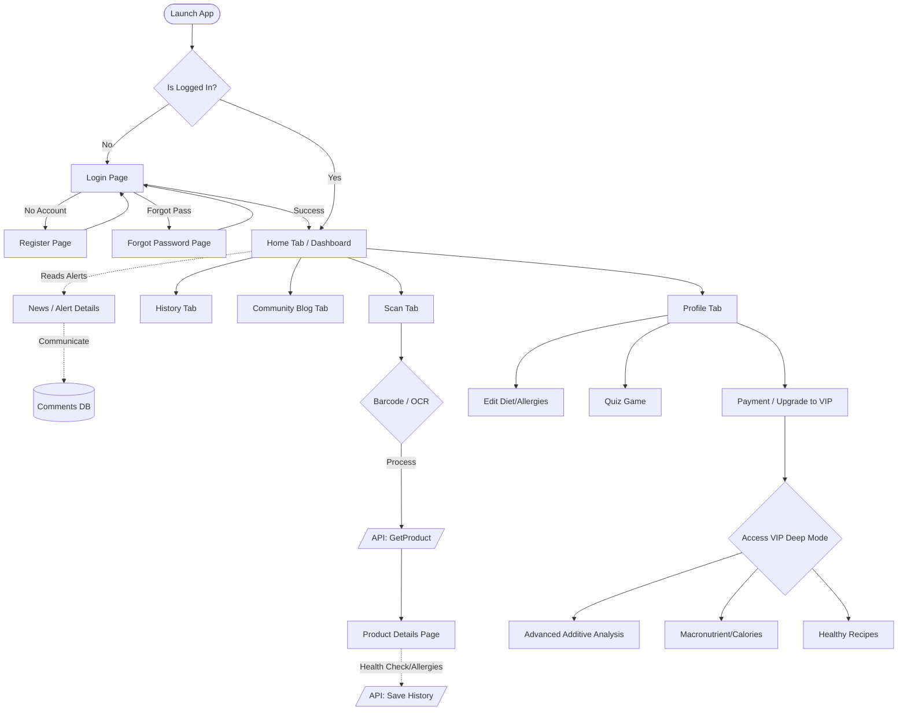
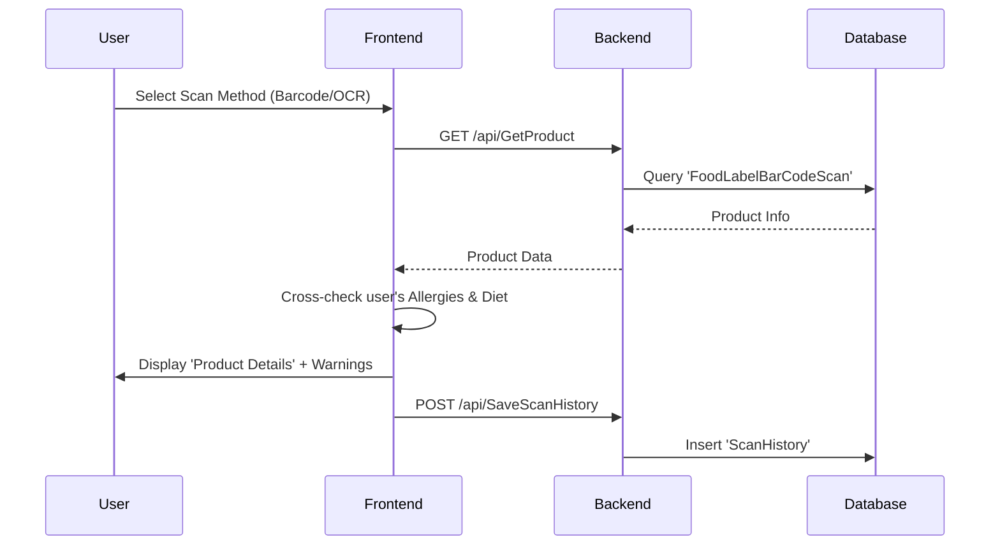
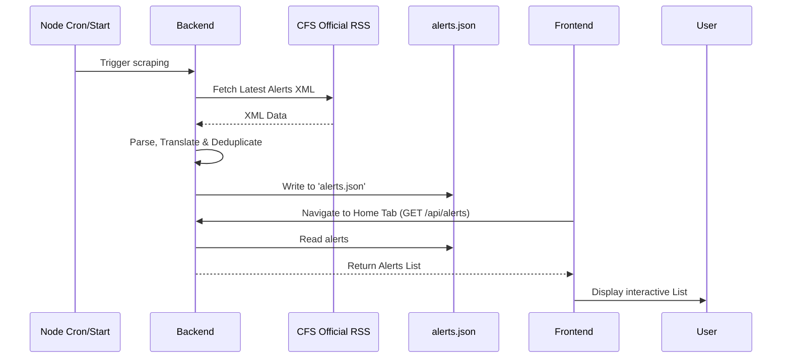
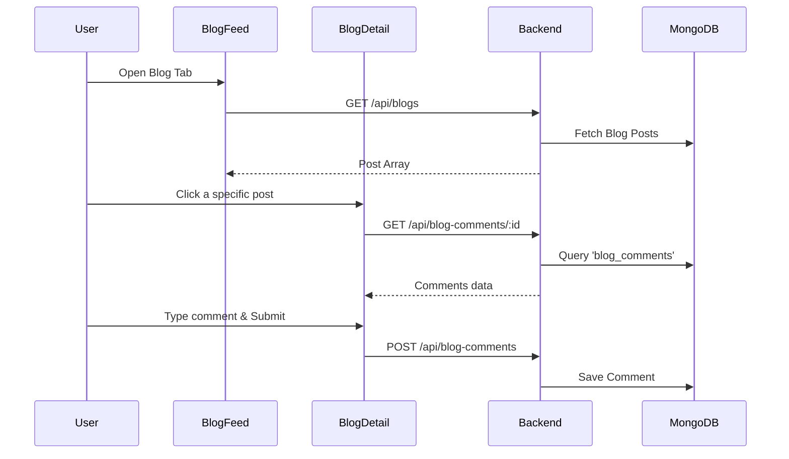
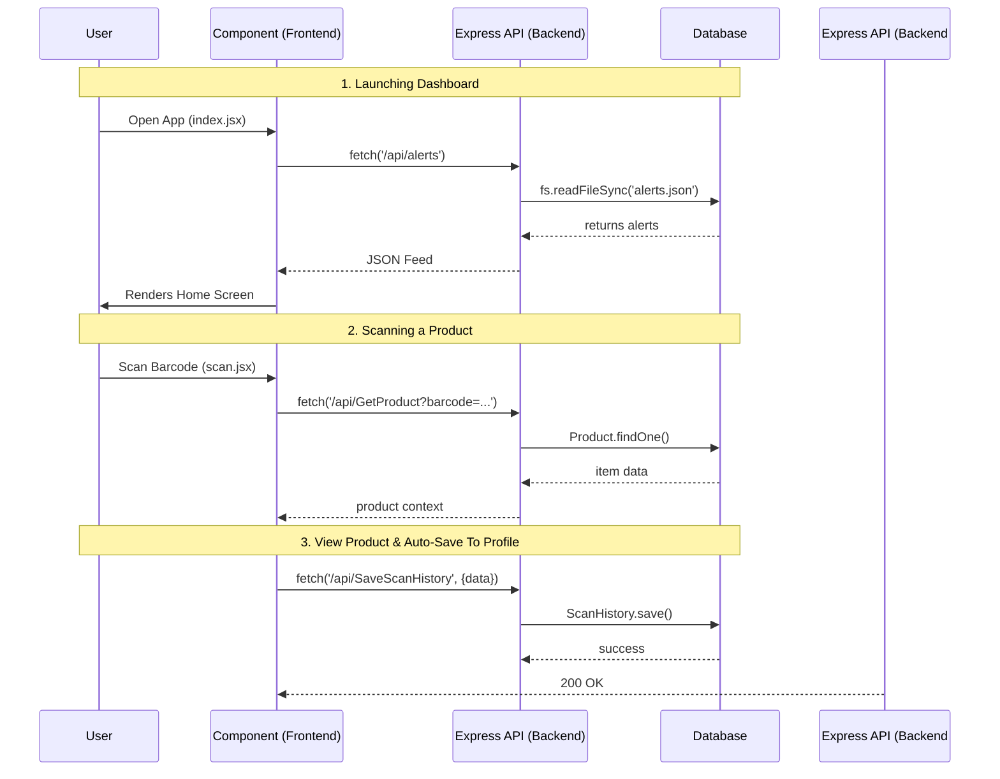

# Application Architecture & Flow Documentation

This document outlines the architecture, flow, and purpose of all major components in the Food Additives Scanning App (Frontend) and its Simple-Backend.

---

## Overall Application Flow

The following diagram illustrates the overarching user journey across the primary modules of the application:

---

## 1. System Overview
The application is a full-stack mobile application.
* **Frontend:** Built with React Native and Expo Router, providing a cross-platform mobile experience (iOS/Android). Uses React Context for state management.
* **Backend:** Built with Node.js and Express. Connects to MongoDB for persistent storage (users, products, blogs, history) and utilizes a local JSON store for storing scraped food safety alerts.

---

## 2. Frontend Architecture & Pages

The frontend (`food_additives_scanning_app`) uses Expo Router for file-based routing mapping directly to the UI structure.

### 2.1 Authentication & Onboarding Flow
* **`app/login.jsx`**: User login page. Authenticates with the backend and updates the `AuthContext` to store the session.
* **`app/register.jsx`**: User registration page. Collects initial data (Email, Password, Username).
* **`app/forgot-password.jsx`**: Trigger an OTP / password reset token to the user's email.
* **`app/edit.jsx`**: Profile editing, allowing users to define personal details (Weight, Height, Allergies, Diet Preferences) to customize their food additive warnings.

### 2.2 Main Tab Navigation (`app/(tabs)`)
The primary interface for authenticated (or guest) users, managed by `_layout.jsx`.
* **`index.jsx` (Home)**: The landing dashboard. Displays the latest scraped Food Safety Alerts and summary info.
* **`scan.jsx` (Scan)**: The core feature. Utilizes the device camera (via Expo Camera) or OCR text recognition to scan product barcodes or ingredient lists. 
* **`history.jsx` (History)**: Displays a log of previously scanned items (`ScanHistory`), fetched from `/api/SaveScanHistory`. Uses `HistoryContext`.
* **`blog.jsx` (Blog)**: A community feed. Users can view, post, and interact with community-driven content.
* **`profile.jsx` (Profile)**: The user's hub. Displays VIP status, settings links, saved coupons, and links to edit dietary profiles.

### 2.3 Feature & Detail Pages
* **`app/product-details.jsx`**: Shown after a successful scan. It presents the product's nutritional information, flags dangerous additives, and cross-references them with the user's personalized allergies and health status.
* **`app/news-details.jsx`**: Expanded view for Food Safety Alerts accessed from the Home tab. Users can read advisory text and read/post comments (`app.post('/api/SaveComment')`).
* **`app/quiz-game.jsx`**: A gamified feature offering educational questions about food safety. Users earn coupons/rewards for correctly answering.
* **`app/payment.jsx` / `upgrade-to-vip.jsx`**: The monetization flow allowing users to purchase a VIP subscription to unlock deep modes and unlimited scans.
* **`app/settings.jsx`**: General app preferences and account actions (e.g., logout, change language).

### 2.4 Blog Sub-routes
* **`app/blog/[id].jsx`**: Detailed view of a specific community blog post with comment threads.
* **`app/blog/create.jsx`**: Editor to create a new blog post.
* **`app/blog/favorites.jsx`**: View list of bookmarked/favorited blog posts.

### 2.5 VIP Deep Mode (`app/vip/`)
Restricted area for premium users providing advanced analytics.
* **`analysis.jsx`**: Provides deeper chemical/additive classifications (e.g., NOVA Classifications, hidden allergens).
* **`calories.jsx`**: Advanced macronutrient balance calculations tied to the user's logged height and weight.
* **`recipes.jsx`**: Suggests healthy alternatives or recipes based on scanned items.

### 2.6 Context Providers (`context/`)
* **`AuthContext.jsx`**: Manages user login state, VIP status, and dietary profile globally.
* **`LanguageContext.jsx`**: Handles app localization (e.g., toggling between English and Traditional Chinese) affecting components like `TranslateButton.jsx`.
* **`AlertContext.jsx`**: Caches and provides the Food Safety Alerts data across screens.
* **`HistoryContext.jsx`**: Manages the local state of user scan histories.

### 2.7 Frontend Services & Components (`services/` & `components/`)
* **`services/ocrService.js`**: Connects to the **Poe AI API** to perform visual analysis and OCR. It takes a base64 encoded image, passes it to the AI model, and instructs the AI to extract and translate food ingredients, nutrition, and product details into a highly structured English format. 
* **`services/productService.js`**: Contains API wrappers for communicating with the backend's `/api/GetProduct` and managing the cross-checking rules logic.
* **`components/TranslateButton.jsx`**: A reusable UI widget that leverages `LanguageContext.jsx` to swap app languages globally.

---

## 3. Main Workflows

### 3.1 The Product Scanning Workflow
1. User navigates to **Scan Tab**.
2. Camera reads a Barcode or OCR captures ingredient text.
3. App calls backend: `GET /api/GetProduct?barcode=...`
4. Backend checks MongoDB `FoodLabelBarCodeScan`. If not found, it might return a "Not Found" handling.
5. Once data is returned, app navigates to `product-details.jsx`.
6. `product-details` cross-checks the ingredients against the user's "allergies" and "healthStatus" saved in `AuthContext`.
7. Results are logged to the backend: `POST /api/SaveScanHistory`.
8. (If non-VIP) The backend tracks scan quota `GET /api/GetScanQuota` & `/api/UseScanQuota`.

### 3.2 Food Safety Updates Workflow (Backend-Driven)
1. Backend scheduled jobs / `initDatabase.js` run on server start.
2. Services fetch historical CFS (Centre for Food Safety) data and parse RSS Feeds (`rssParser.js`, `historyApi.js`).
3. App displays alerts on the **Home Tab**.
4. User clicks an alert -> Opens `news-details.jsx` -> Can read reason, actions taken, and leave comments.

### 3.3 Community/Blog Workflow
1. User opens **Blog Tab**.
2. Frontend loads posts (`GET /api/blogs`).
3. User selects a post (`app/blog/[id].jsx`).
4. User reads comments or writes a new one (`POST /api/blog-comments`).
5. User can like (`POST /api/blog-likes`) or favorite (`POST /api/favorites`).

---

## 4. System Communication Architecture
This section describes how the Frontend (Mobile App), Backend (Node.js/Express), and Databases communicate with one another.

### 4.1 Frontend to Backend Communication
The Expo React Native frontend communicates with the Simple-Backend via RESTful HTTP APIs.
* **Protocol:** HTTPS / HTTP (for local testing).
* **Data Format:** JSON payloads (`application/json`).
* **State Management:** Using React Context. For instance, the `AuthContext` holds user credentials and IDs, which are appended in the URL query string or body of requests (e.g., `?userId=X`).
* **Client Library:** Using `fetch` or `axios` in various service files.

### 4.2 Backend to Database Communication
The Express server acts as a middleman, communicating with two distinct data layers:
1. **MongoDB:** Connected using `mongoose` ODM (Object Data Modeling). The backend maintains a persistent TCP connection pool to the MongoDB server, running queries (Find, Insert, Update, Delete) securely.
2. **Local File System (JSON):** Using Node.js native `fs` module to read, write, and parse the `alerts.json` file asynchronously.

### 4.3 High-Level Communication Diagram

### 4.4 Feature Triggers & API Flow Examples

This table and diagram show **exactly which frontend actions** trigger these backend communications:

1. **Authentication:** 
   * **Trigger:** User taps "Login" (`login.jsx`)
   * **Flow:** `Frontend (fetch)` ➔ `Backend (POST /api/login)` ➔ `MongoDB (User Schema)` ➔ Returns user session.
2. **Dashboard Initialization:** 
   * **Trigger:** User opens the Home Tab (`index.jsx`). The `AlertContext` mounts.
   * **Flow:** `Frontend (fetch)` ➔ `Backend (GET /api/alerts)` ➔ `Local System (read alerts.json)` ➔ Returns JSON Feed.
3. **Product Scanning:** 
   * **Trigger:** User completes barcode scan (`scan.jsx`).
   * **Flow:** `Frontend (fetch)` ➔ `Backend (GET /api/GetProduct)` ➔ `MongoDB (FoodLabelBarCodeScan)` ➔ Returns nutritional info.
4. **Saving History:** 
   * **Trigger:** Scan resolves and `product-details.jsx` is rendered.
   * **Flow:** `Frontend (fetch)` ➔ `Backend (POST /api/SaveScanHistory)` ➔ `MongoDB (ScanHistory Schema)` ➔ Confirms save.

---

## 5. Backend Architecture & Endpoints

Located in `simple-backend/`, the Node server (`server.js`) utilizes Express.

### 4.1 Product & Scanning APIs
* `GET /api/GetProduct` - Look up a product by barcode.
* `POST /api/SaveScanHistory` - Save a user's scan result/health analysis.
* `DELETE /api/DeleteScanHistory` - Remove an item from history.
* `GET /api/GetScanQuota` / `POST /api/UseScanQuota` - Limits daily scans for free users.

### 4.2 User & Auth APIs
* `POST /api/register` / `api/login` - Standard JWT/Session based authentication.
* `POST /api/user/update` - Update demographics, allergies, and VIP status.
* `POST /api/forgot-password` / `verify-otp` / `reset-password-final` - Password recovery flow.
* `POST /api/user/coupon` - Awards user coupons from the Quiz game.

### 4.3 Community & Blog APIs
* `GET /api/blogs` / `POST /api/blogs` - Fetch and create blog posts.
* `GET /api/blogs/:id` - Fetch single blog post details.
* `POST /api/blog-comments` / `GET /api/blog-comments/:postId` - Manage blog discussions.
* `POST /api/favorites` / `DELETE /api/favorites` / `GET /api/favorites/:userId` - Bookmark posts.
* `POST /api/blog-likes` / `GET /api/blog-likes/:postId` - Like/Dislike engagement.

### 4.4 News & Alerts APIs
* `GET /api/alerts` (via `routes/alerts.js`) - Returns the latest safety alerts from `data/alerts.json`.
* `POST /api/SaveComment` / `GET /api/GetComments` - Comments specifically attached to News/Alerts ID.

### 5.5 Backend Services Structure & Utilities
* **`services/ckanApi.js`**: Fetches the location of the latest RSS/XML feeds directly from the data.gov.hk (CKAN) API metadata endpoint.
* **`services/rssParser.js` & `scraper.js`**: Reaches out to official external government feeds (like CFS) to scrape incident data and HTML descriptions.
* **`services/alertService.js`**: Handles reading/writing the `alerts.json` to prevent DB bloat with temporary news items. Updates and deduplicates alerts.
* **`utils/dateHelper.js`**: Utility leveraging `dayjs` to standardize timezone parsing to Asia/Hong_Kong UTC+8.
* **`utils/logger.js`**: Basic local logging service formatting output into `data/app.log`.
* **`initDatabase.js` & `updateAlerts.js`**: Utility scripts intended to be run manually or via cron to seed and refresh backend data from remote RSS XMLs.