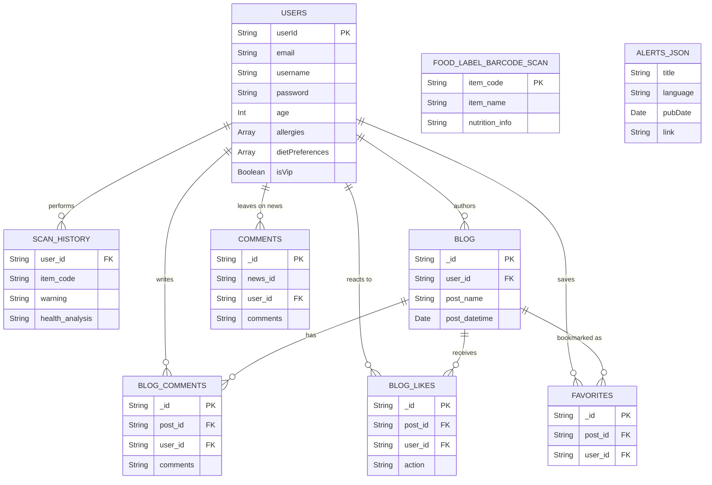

# Database Structure

The application operates with a hybrid data architecture, primarily utilizing **MongoDB** (via Mongoose) as the main database for users, products, interactions, and community features, accompanied by a local **JSON store** (`data/alerts.json`) for Food Safety Alerts scraped from external sources.

## Entity-Relationship Diagram

## 1. MongoDB Collections

Below are the defined MongoDB schemas currently present in the backend (`simple-backend/server.js`). Many of these use `{ strict: false }`, allowing the schemas to accept dynamic fields beyond what is formally defined.

### 1.1 `users`
Stores user profiles, customization settings, and authentication details.
* **`userId`** (String) - Unique identifier.
* **`email`** (String) - Unique and required.
* **`username`** (String) - Required.
* **`password`** (String) - Required.
* **`dob`** (String) - Date of birth.
* **`age`** (Number) - User's age.
* **`height`** (String) - User's height.
* **`weight`** (String) - User's weight.
* **`allergies`** (Array of Strings) - Recorded food allergies.
* **`dietPreferences`** (Array of Strings) - E.g., Vegan, Halal.
* **`healthStatus`** (Array of Strings) - E.g., Diabetic, High Blood Pressure.
* **`isVip`** (Boolean) - Default: `false`.
* **`coupons`** (Array of Objects):
  * `code` (String)
  * `discount` (String)
  * `partner` (String)
  * `dateWon` (Date) - Default: `Date.now`
* **`favoritePosts`** (Array of Strings)
* **`resetOTP`** (String) - Used for password resets.

### 1.2 `FoodLabelBarCodeScan` (Products)
Stores data about scanned products.
* **`item name`** (String)
* **`item code`** (String) - Barcode/UPC used for scanning.
* **`nutrition information`** (String) - Raw or processed nutrition facts.

### 1.3 `ScanHistory`
Logs scan activities per user to provide historical insights and health analysis.
* **`item name`** (String)
* **`item code`** (String)
* **`nutrition information`** (String)
* **`user id`** (String)
* **`warning`** (String) - Additives or allergen warnings flagged.
* **`health analysis`** (String) - Specific health-related output or evaluation.

### 1.4 `comments`
Stores interactions or reviews related to general news/alerts.
* **`user id`** (String)
* **`user name`** (String)
* **`comments`** (String)
* **`time`** (String)
* **`district`** (String)
* **`news id`** (String)

### 1.5 `blog`
Community or system blog posts.
* **`post name`** (String) - Title of the post.
* **`post content`** (String) - Body of the blog post.
* **`post datetime`** (Date) - Default: `Date.now`.
* **`user id`** (String) - Author.

### 1.6 `blog comments`
Discussions underneath blog posts.
* **`post id`** (String)
* **`comments`** (String)
* **`comments datetime`** (Date) - Default: `Date.now`.
* **`district`** (String)
* **`user id`** (String)
* **`user name`** (String)

### 1.7 `favorites`
Records of a user's favorite posts.
* **`post id`** (String)
* **`user id`** (String)

### 1.8 `blog_likes`
Like/Dislike reactions on blogs.
* **`post id`** (String)
* **`user id`** (String)
* **`action`** (String) - Enum allowing only `['like', 'dislike']`.

---

## 2. Local File-Based Data

### 2.1 Food Safety Alerts (`simple-backend/data/alerts.json`)
The system irregularly scrapes and stores external RSS feeds (e.g., from CFS) directly into a local JSON store for quick retrieval and lower database overhead.

**General Structure included in the JSON Array objects:**
* **`title`** (String) - Alert headline.
* **`description`** (String) - HTML content of the alert details.
* **`link`** (String) - URL pointing back to the official alert source.
* **`pubDate`** / **`publishDate`** (String Date) - Date the alert was issued.
* **`language`** (String) - `en` (English) or `tc` (Traditional Chinese).
* **Detailed Extraction Fields** (Strings):
  * `foodItem`
  * `productDetails`
  * `reason` - Reason for the recall/alert.
  * `actionTaken`
  * `adviceToTrade`
  * `adviceToConsumers`
* **`productInfo`** (Object):
  * `productName` (String)
  * `brand` (String)
  * `origin` (String)
  * `batch` (String)
