# Sequence Diagrams

This document contains the Sequence Diagrams for the Food Additives Scanning App, based on the provided Activity Diagrams and the codebase implementation.

## 1. Login Workflow

**Description:**
The user enters their credentials. The system first validates if fields are empty. If valid, it sends a request to the server. The server verifies the user against the database. On success, a token is returned and saved locally.

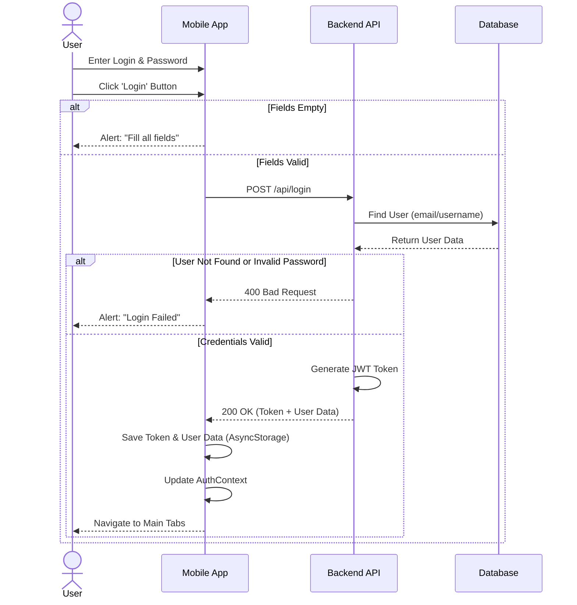

## 2. Register Workflow

**Description:**
The user enters registration details. The system checks if passwords match. If they do, the data is sent to the server. The server checks for existing users before creating a new account.

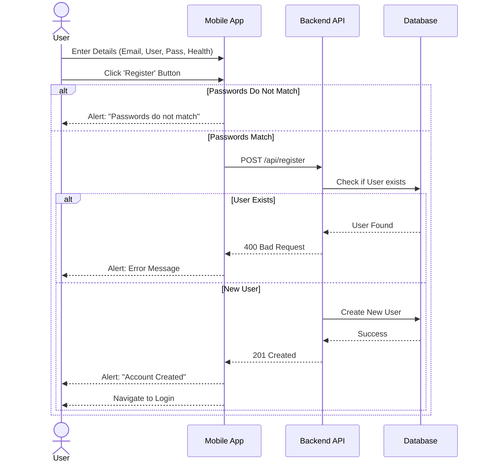

## 3. Scan Workflow (Barcode & OCR)

**Description:**
The user selects a mode. The app checks the scan quota for non-VIP users. In **OCR Mode**, an image is analyzed by Poe AI, then the user edits the text. In **Barcode Mode**, the product is fetched from the `FoodLabelBarCodeScan` DB. It cross-checks user allergies/diet, logs the scan to `ScanHistory`, and uses a quota.

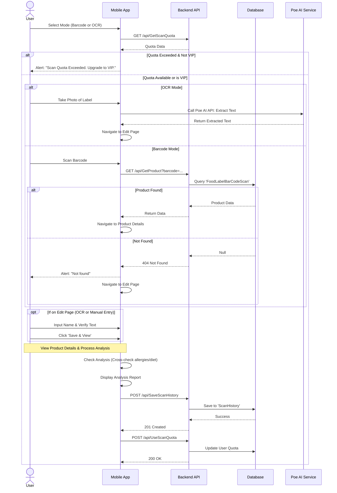

## 4. Forgot Password Workflow

**Description:**
The user requests a password reset. An OTP is sent and stored in the database (`resetOTP`). The user verifies the OTP and sets a new password.

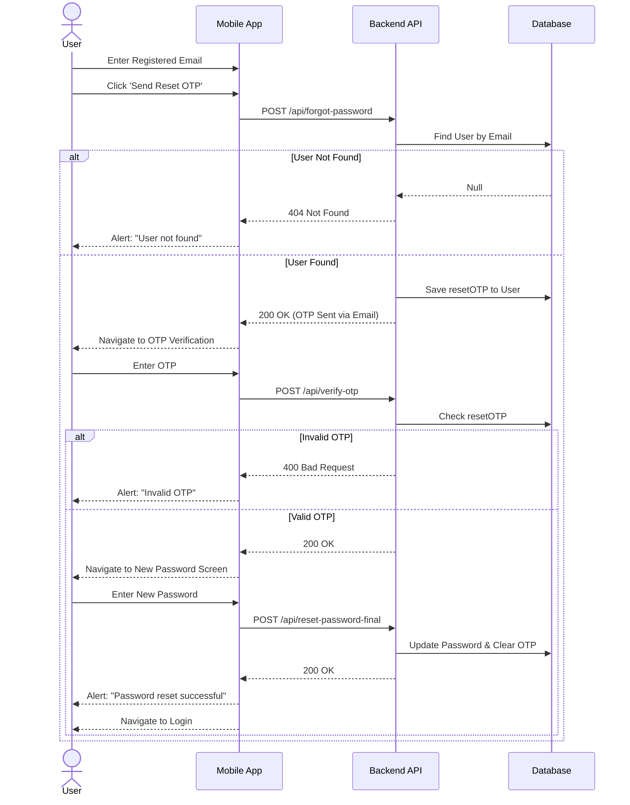

## 5. Logout Workflow

**Description:**
The user initiates logout from the profile tab. The application clears the local user state (Context) and removes the persistent authentication token from storage.

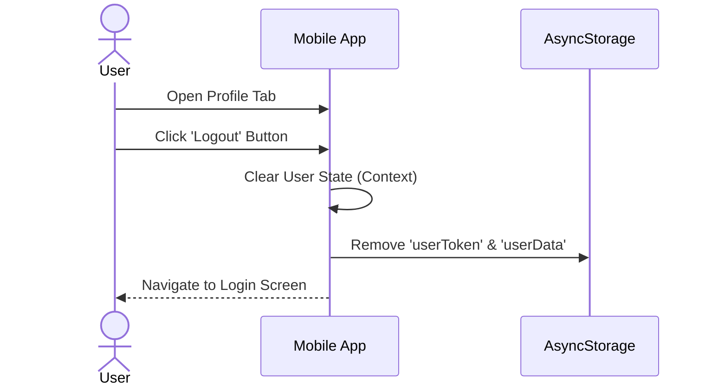

## 6. History Workflow

**Description:**
The user views their past scans. The app loads this data from local storage. The user can view details or delete items.

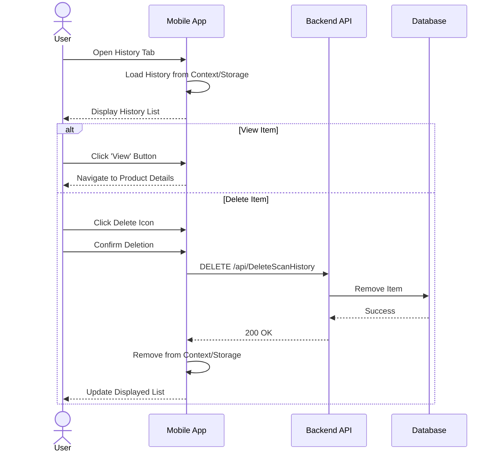

## 7. Blog Workflow

**Description:**
Users can browse community posts, create their own posts, and engage by commenting, liking, and saving favorites.

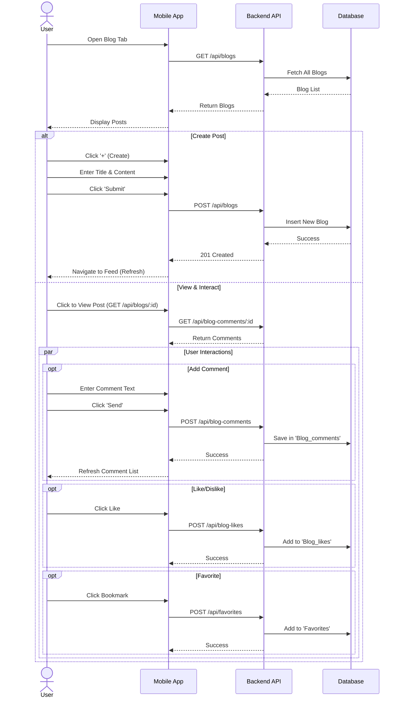

## 8. News Workflow

**Description:**
Users read food safety alerts scraped from data.gov.hk. The frontend reads from the local `alerts.json` file, and users can leave comments tied to specific alerts.

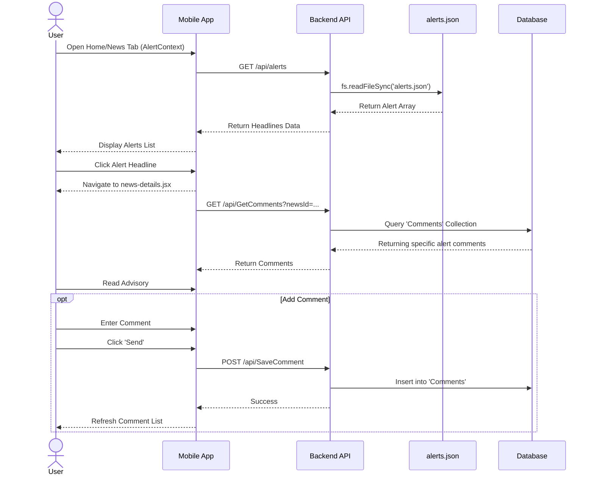

## 9. Profile Management Workflow

**Description:**
Users can update their personal information. Changes are sent to the server and the local user context is updated.

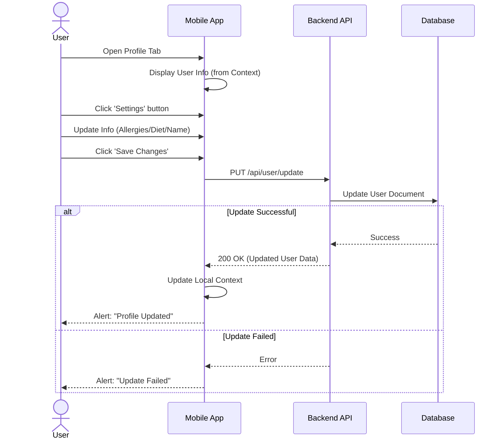

## 10. VIP Upgrade Workflow

**Description:**
Users can subscribe to a VIP plan. The app interfaces with an external payment flow to process the transaction. Once the payment is verified, the user's status is upgraded in the database.

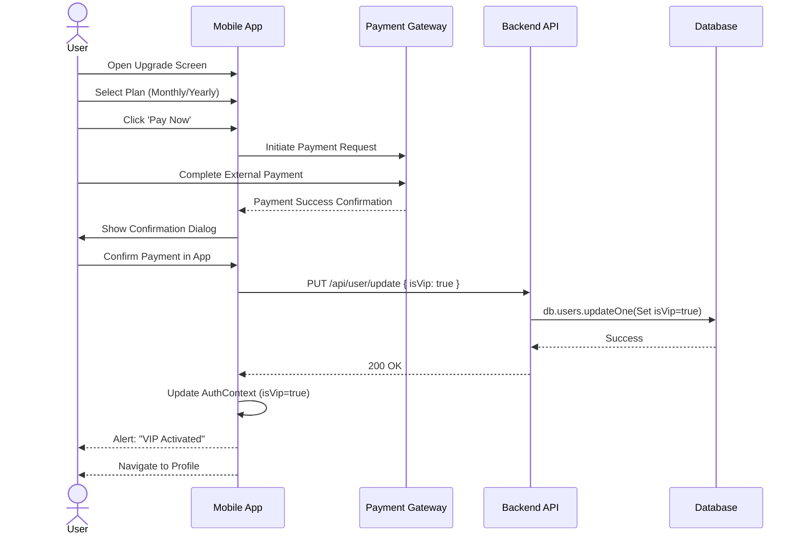

## 11. VIP Features Workflow

**Description:**
VIP users access exclusive features. The system checks VIP status before granting access.

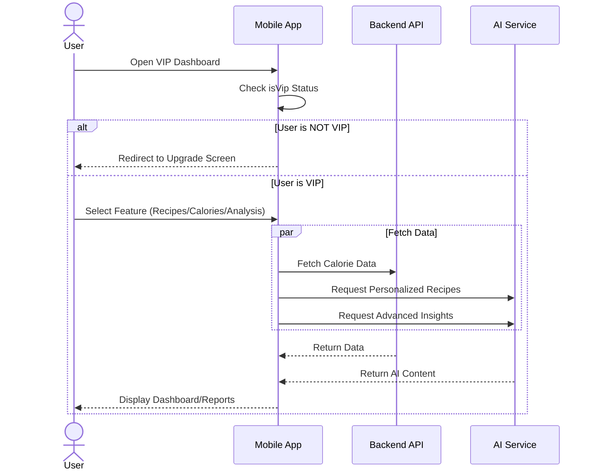

## 12. Discount Game Workflow

**Description:**
A gamified feature where users answer dynamically generated trivia questions focused on food safety or additives to win coupons. The system uses an AI service to dynamically generate the quiz questions.

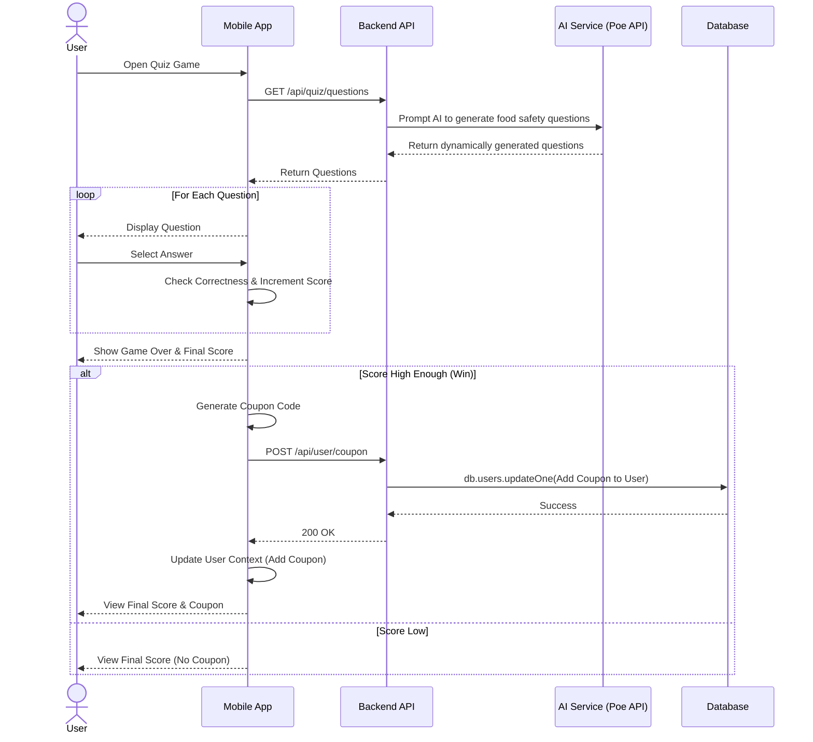

## 13. Backend Scraper & Alert Update Workflow

**Description:**
A scheduled automated process where the Node.js backend fetches the latest food safety alerts from the external government API (data.gov.hk / CFS), parses the data, and caches it locally to `alerts.json` to prevent database read overload.

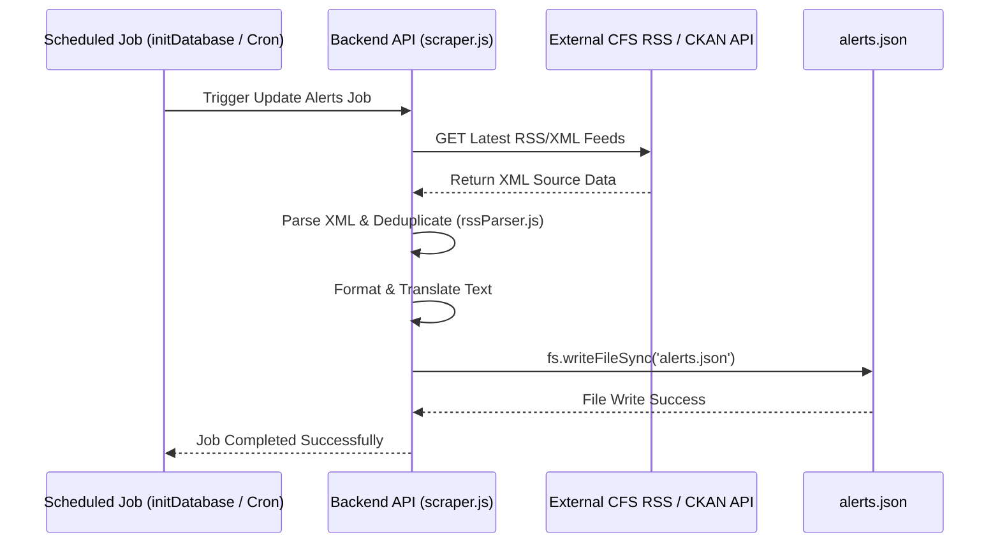

## 14. Multilingual Toggle Workflow

**Description:**
The user switches the interface language (e.g., English to Traditional Chinese). The application updates the global state via `LanguageContext`, prompting all dependent react components to logically re-render in the selected language.

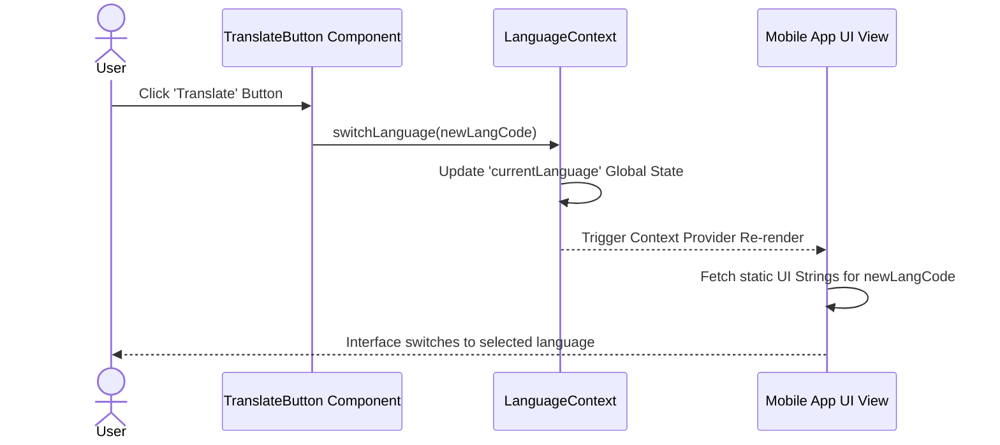
