# Sequence Diagrams

This document contains the Sequence Diagrams for the Food Additives Scanning App, based on the provided Activity Diagrams and the codebase implementation.

## 1. Login Workflow

**Description:**
The user enters their credentials. The system first validates if fields are empty. If valid, it sends a request to the server. The server verifies the user against the database. On success, a token is returned and saved locally.

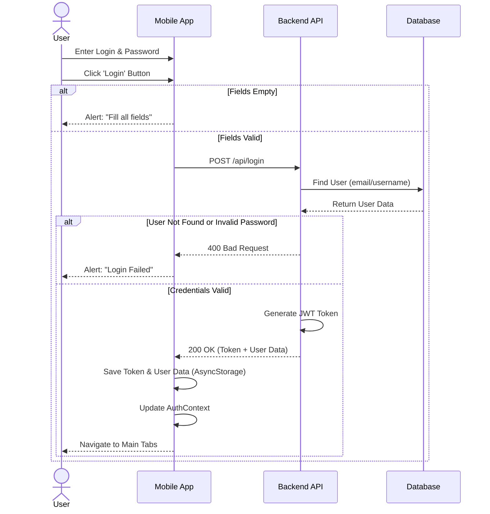

## 2. Register Workflow

**Description:**
The user enters registration details. The system checks if passwords match. If they do, the data is sent to the server. The server checks for existing users before creating a new account.

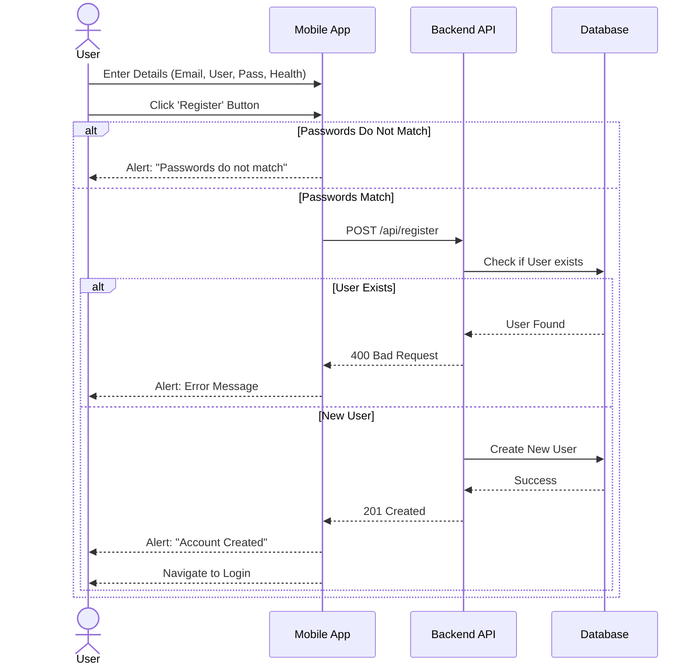

## 3. Scan Workflow (Barcode & OCR)

**Description:**
The user selects a mode. In **OCR Mode**, an image is analyzed by AI, then the user edits/verifies the text. In **Barcode Mode**, the product is fetched from the server; if not found, the user is redirected to the edit page to manually enter details. Both paths lead to saving the scan history and displaying product details with health analysis.

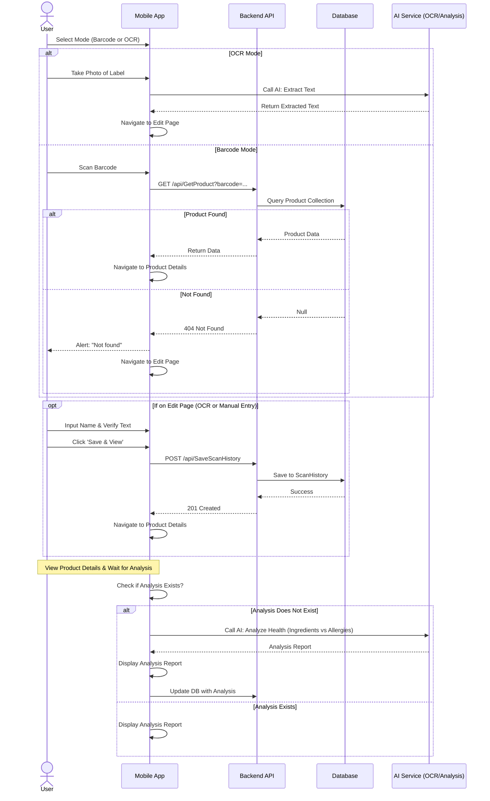

## 4. Forgot Password Workflow

**Description:**
The user requests a password reset by providing their email. The server checks if the email exists in the database. If found, it simulates sending a reset link.

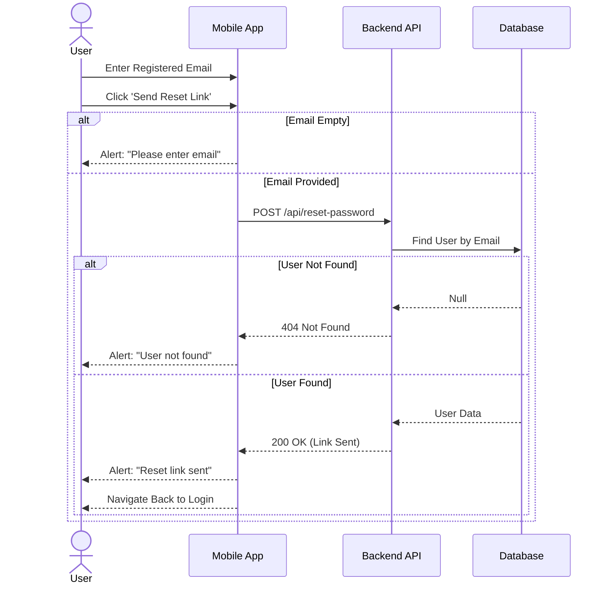

## 5. Logout Workflow

**Description:**
The user initiates logout from the profile tab. The application clears the local user state (Context) and removes the persistent authentication token from storage.

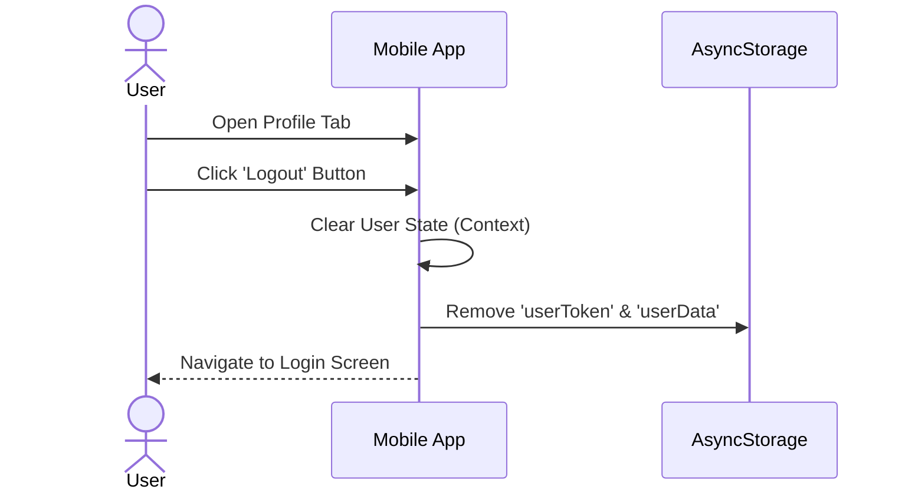

## 6. History Workflow

**Description:**
The user views their past scans. The app loads this data from local storage. The user can view details or delete items.

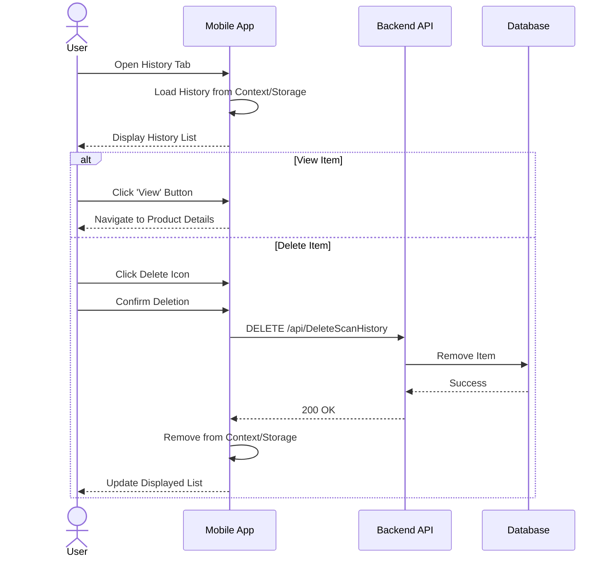

## 7. Blog Workflow

**Description:**
Users can browse community posts, create their own posts, and comment on existing ones.

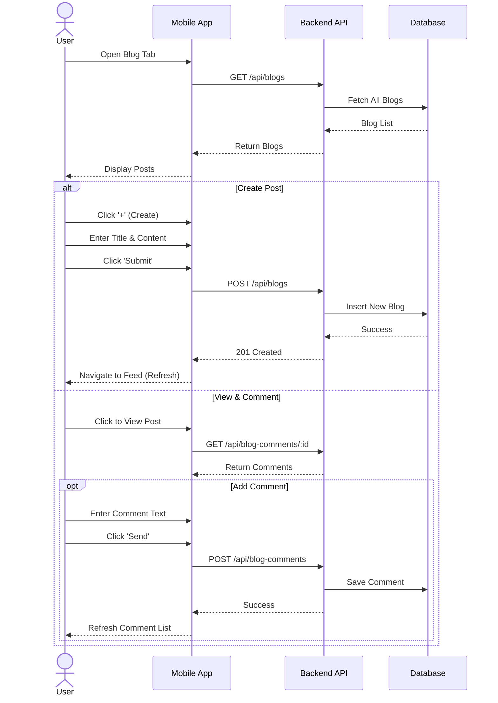

## 8. News Workflow

**Description:**
Users read news articles and discuss them. The app fetches headlines and manages a separate comment system for news.

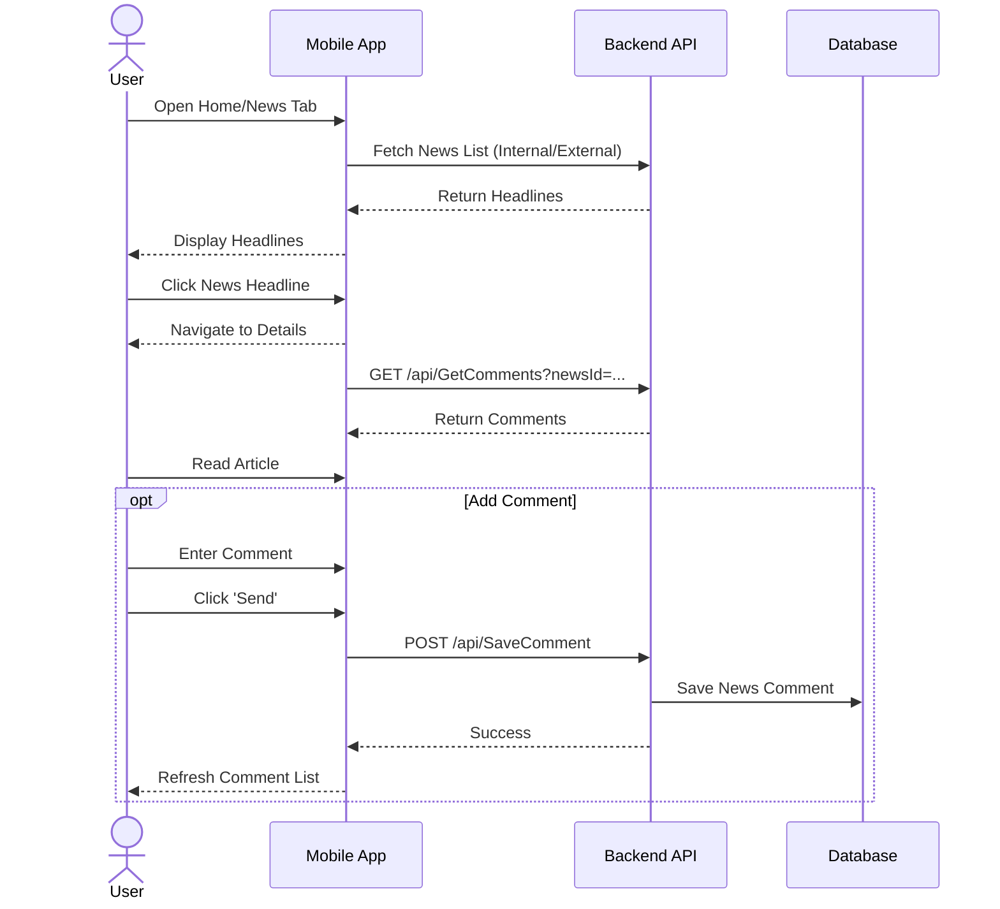

## 9. Profile Management Workflow

**Description:**
Users can update their personal information. Changes are sent to the server and the local user context is updated.

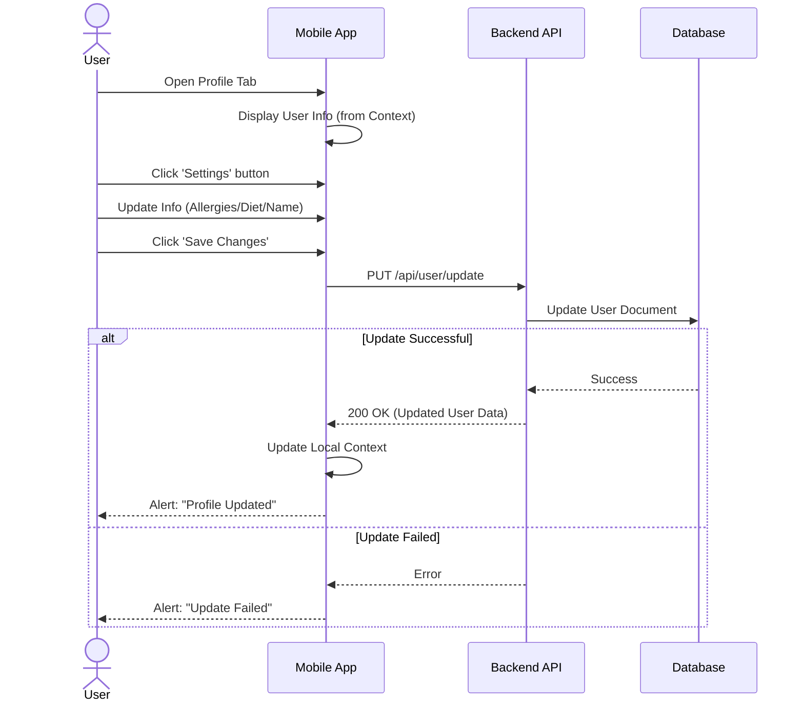

## 10. VIP Upgrade Workflow

**Description:**
Users can subscribe to a VIP plan. The app interfaces with an external payment flow.

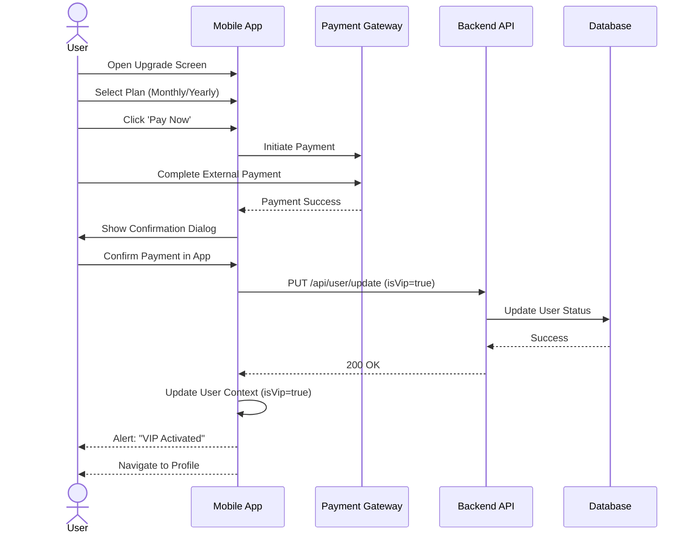

## 11. VIP Features Workflow

**Description:**
VIP users access exclusive features. The system checks VIP status before granting access.

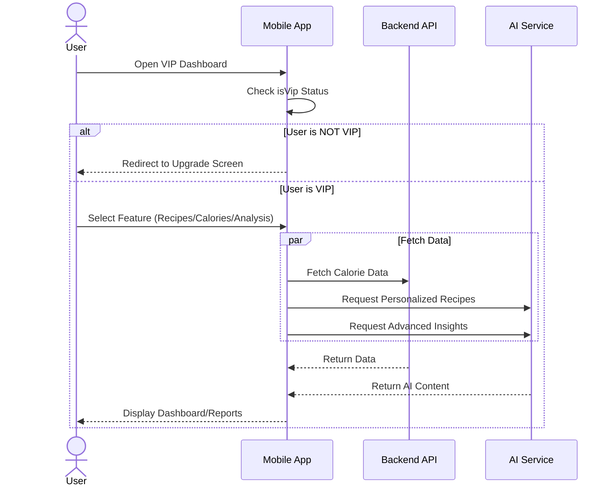

## 12. Discount Game Workflow

**Description:**
A gamified feature where users answer trivia questions to win coupons.

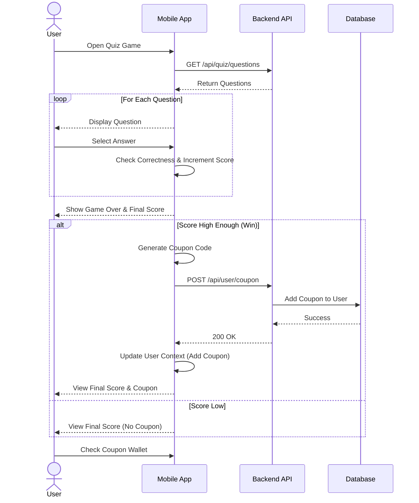
