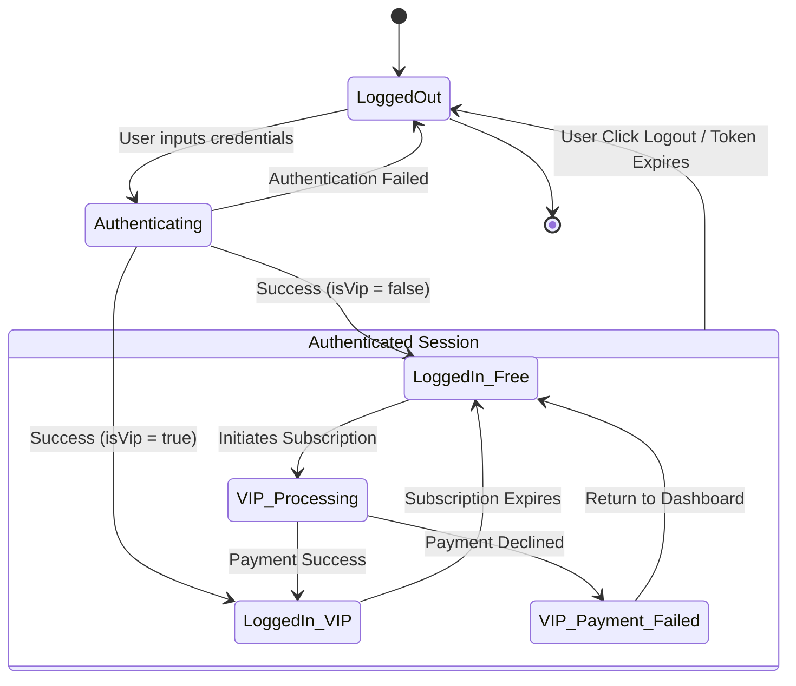
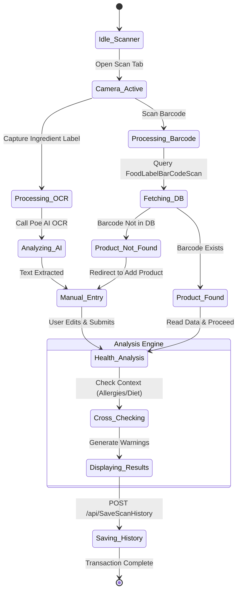
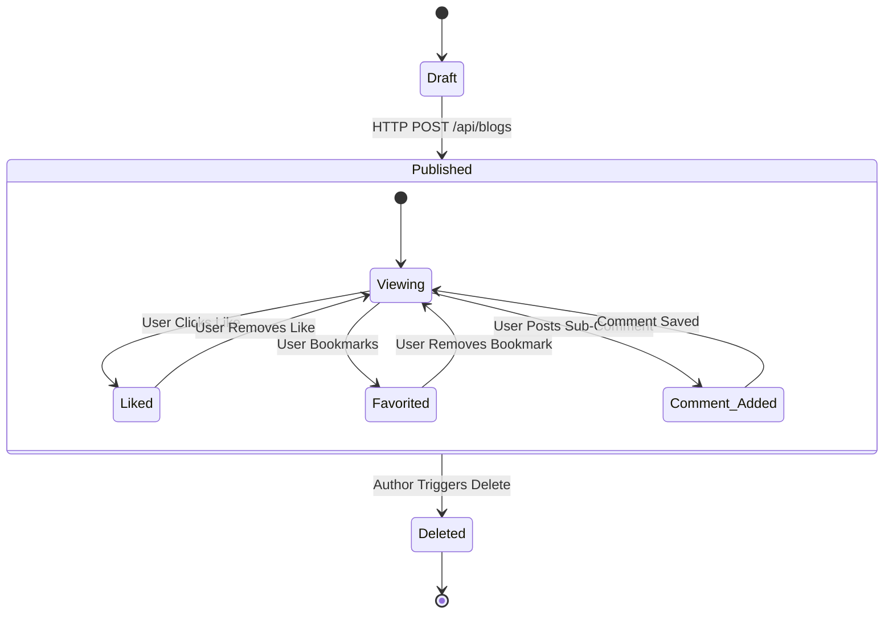
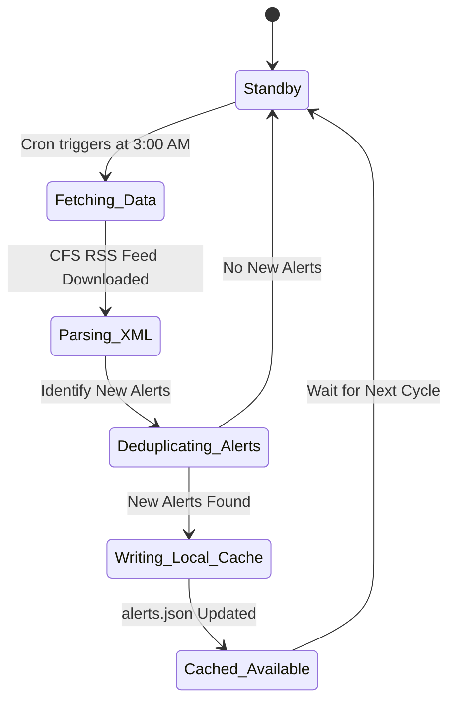
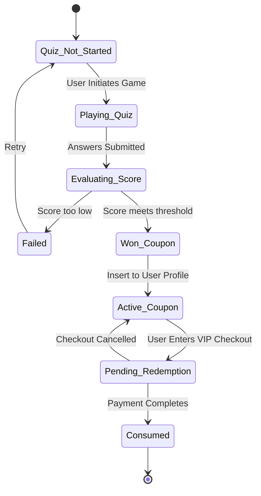
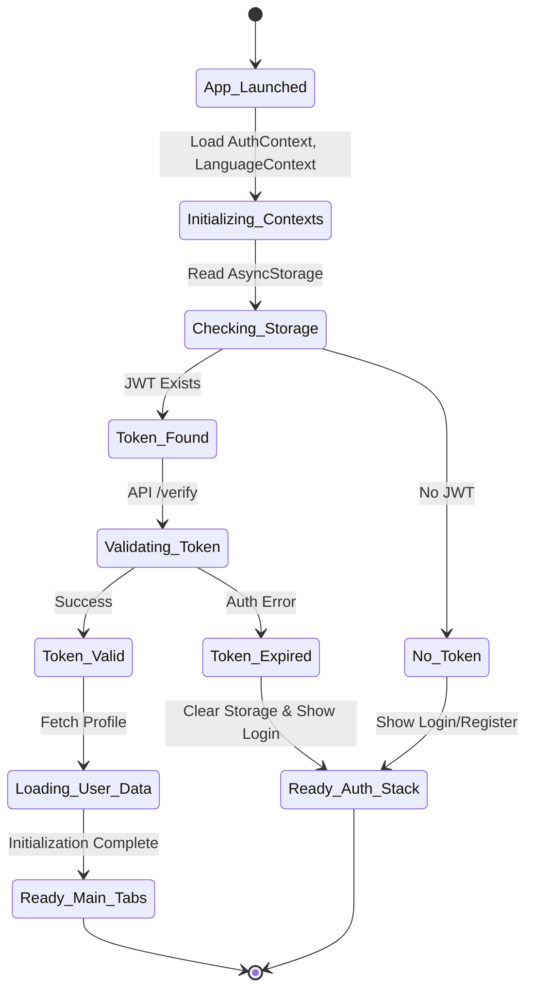
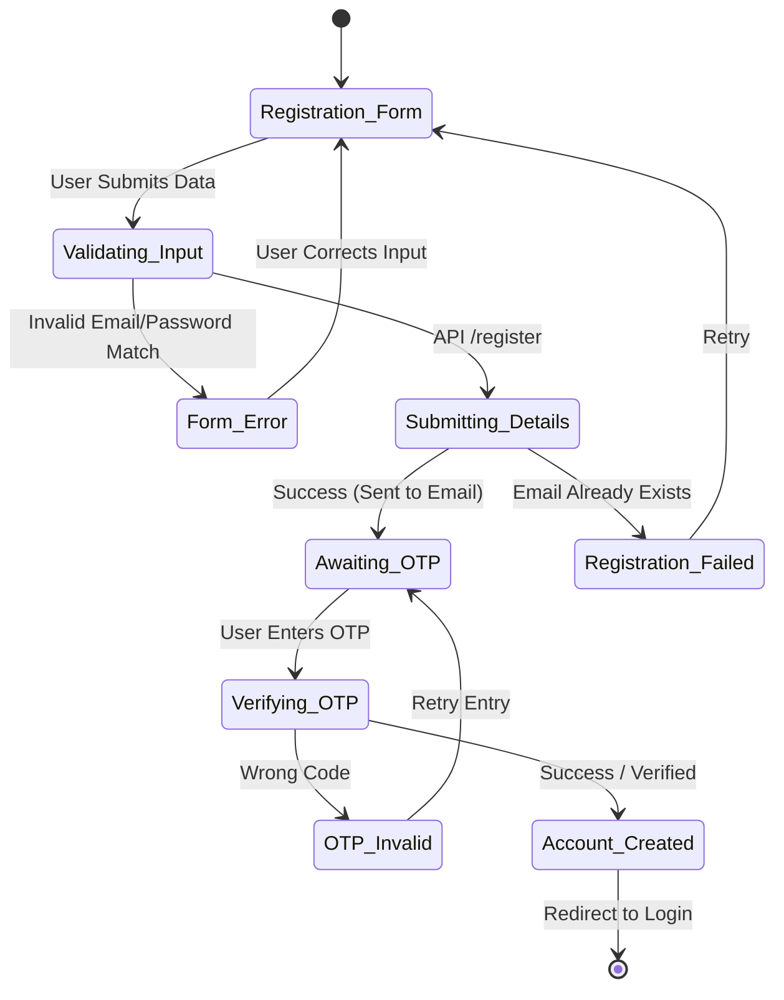
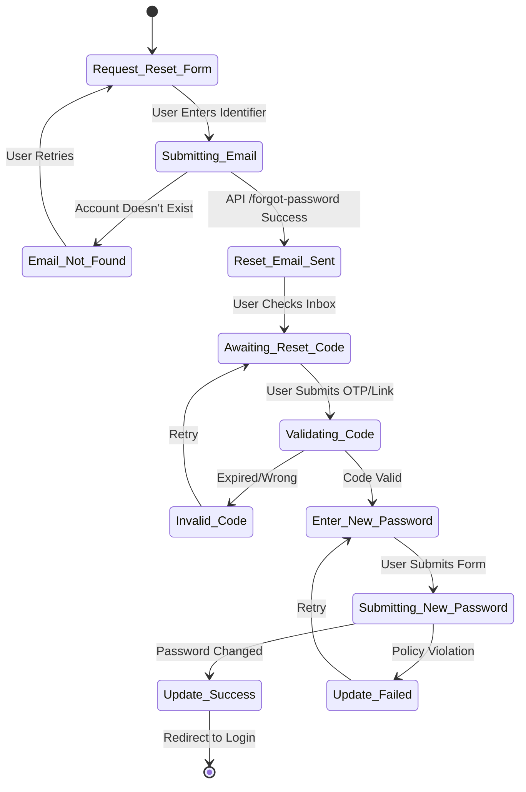
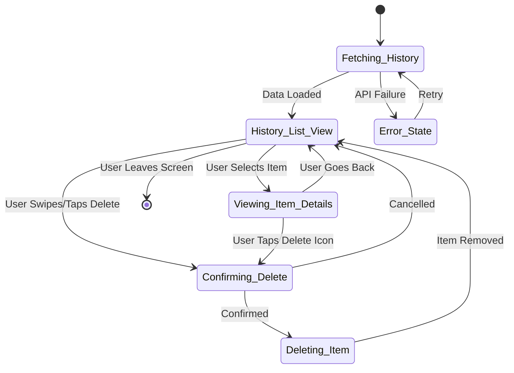
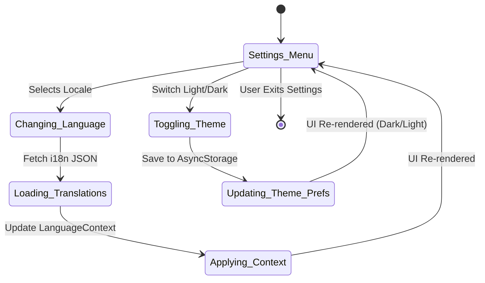

# System State Charts

This document contains the State Machine Diagrams (State Charts) for the Food Additives Scanning App. State charts illustrate the different states an entity or component can reside in during its lifecycle and the triggers that cause state transitions. This is a critical component of the System Design phase.

---

## 1. User Authentication & Session State

**Description:**
This state chart defines the lifecycle of a user's session within the application. It highlights the transition from a guest (Logged Out) to an authenticated user, distinguishing between standard Free users and VIP users. It also models the state change when a user upgrades via the payment gateway or when their session terminates.

---

## 2. Product Scanning & Analysis Lifecycle State

**Description:**
This diagram maps the state of the core scanning mechanism. It handles both Barcode and OCR modes. The states tracking how the system transitions from camera capture, to data extraction, database fetching, user editing, AI analysis cross-referencing user allergies, and finally logging to history.

---

## 3. Blog Post Lifecycle State

**Description:**
This diagram shows the states a Community Blog Post goes through within the system—from draft creation to publication, and how it handles user interactions like comments, likes, and favorites before potential deletion.

---

## 4. Food Safety Alert Data State (Backend)

**Description:**
This state chart visualizes the backend automated scraping cycle. Since the alerts are updated via an async cron job rather than user interaction, this strictly models server-side states.

---

## 5. Discount Quiz & Coupon Gamification State

**Description:**
This models the state of the user's interactive discount quiz, their resulting win/loss condition, and the subsequent lifecycle of the awarded coupon until it is consumed during a VIP upgrade.

---

## 6. App Launch & Initialization

**Description:**
This state chart defines the lifecycle of the application during startup. It covers the loading of contexts (Auth, Language, Theme), checking for existing valid tokens, and routing the user to the appropriate initial screen (Login vs. Home).

---

## 7. Registration & OTP Validation Lifecycle

**Description:**
This state chart maps the states a user goes through when creating a new account. It includes form validation, API submission, the OTP verification layer, and the final account creation outcome.

---

## 8. Forgot Password Lifecycle

**Description:**
This diagram maps the password recovery process. It transitions from requesting a reset, confirming ownership via a reset link or OTP, establishing a new password, and completing the reset cycle.

---

## 9. History Management State (List, View, Delete)

**Description:**
This state chart covers how a user interacts with their scanned food history. It shows the fetching of the history list, viewing detailed results for a specific scan, and the deletion flow.

---

## 10. App Configuration & Language State

**Description:**
This state chart outlines the system's management of global configuration settings, specifically focusing on toggling themes or switching localizations/languages dynamically.

