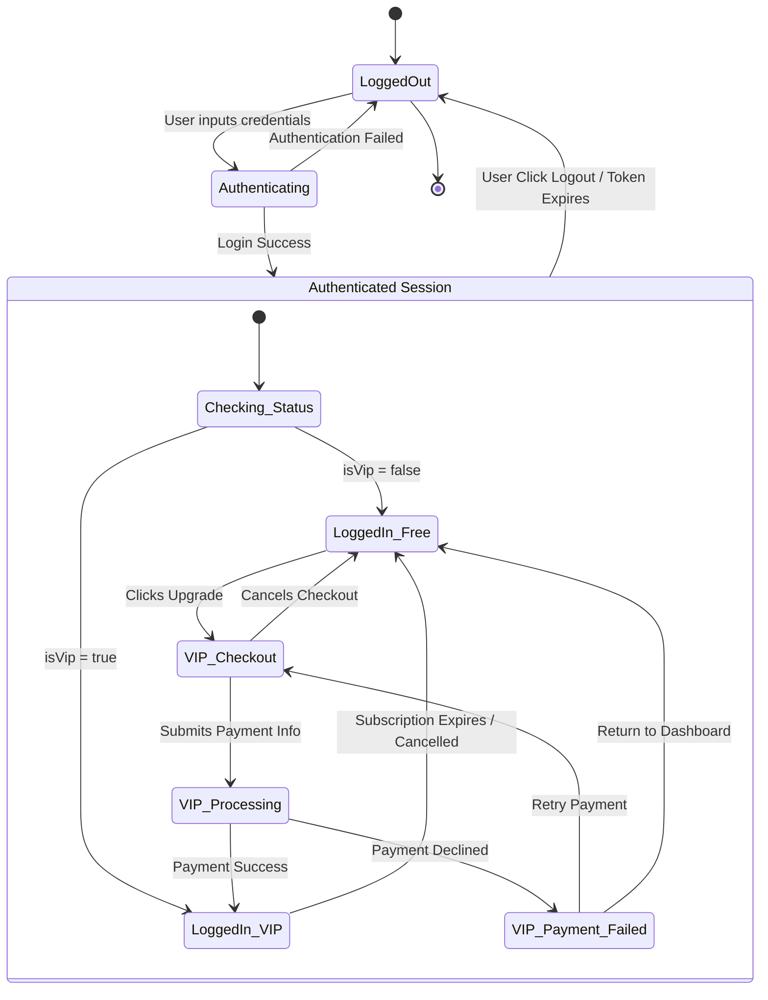
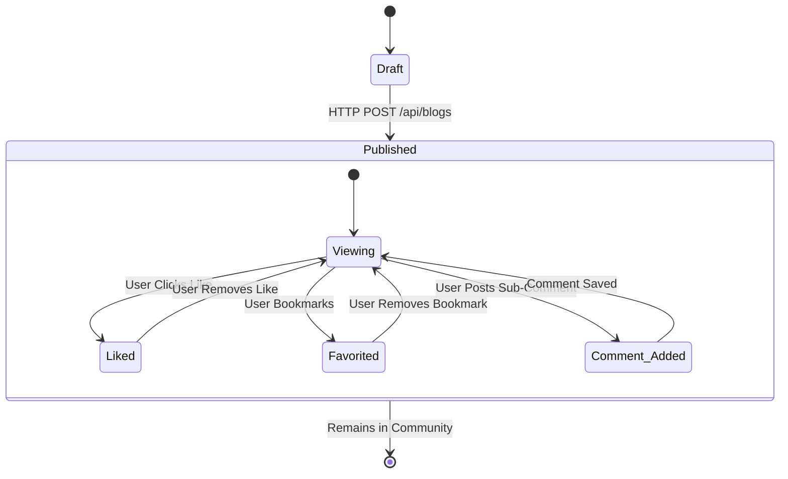
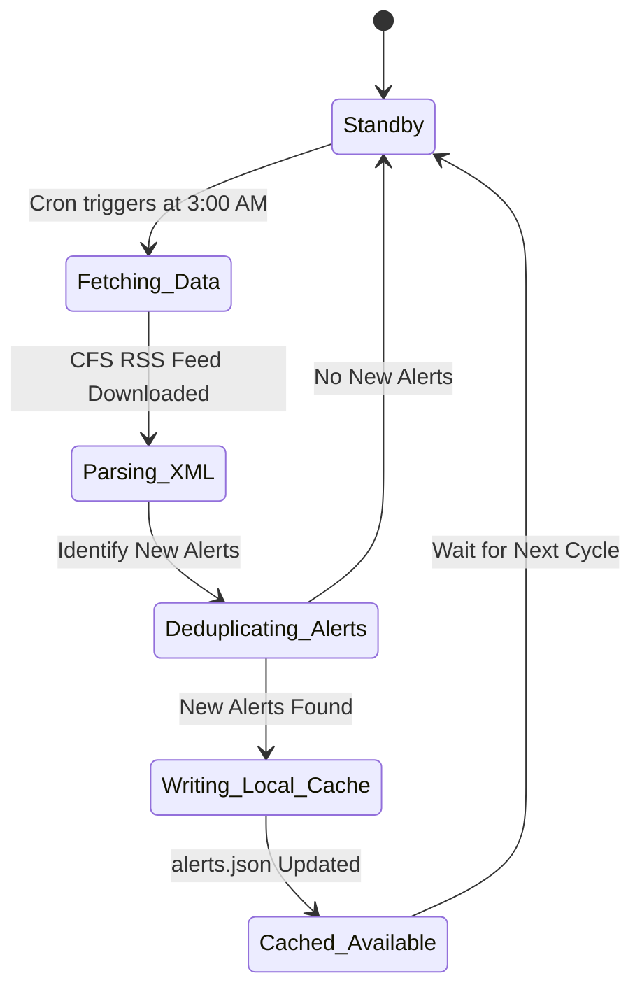
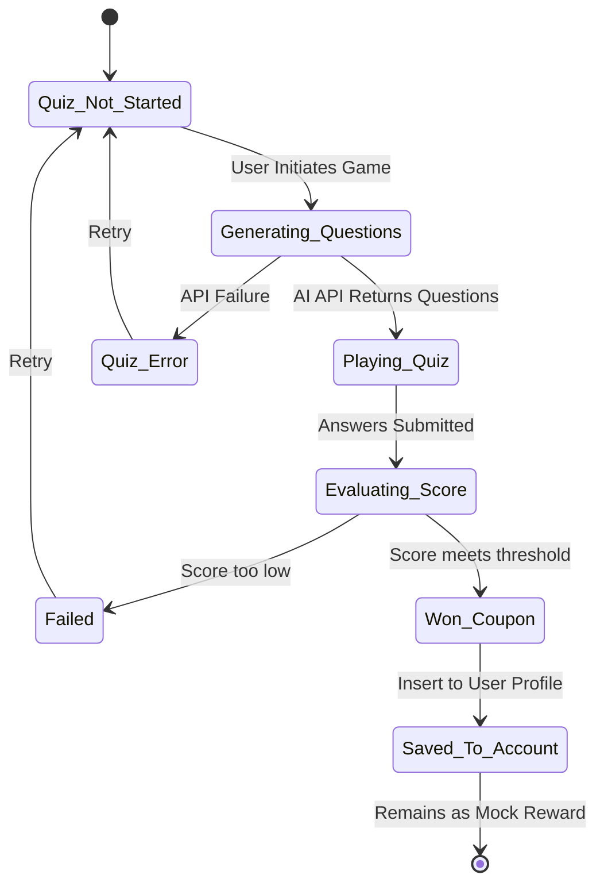

# System State Charts

This document contains the State Machine Diagrams (State Charts) for the Food Additives Scanning App. State charts illustrate the different states an entity or component can reside in during its lifecycle and the triggers that cause state transitions. This is a critical component of the System Design phase.

---

## 1. User Authentication & Session State

**Description:**
This state chart defines the lifecycle of a user's session within the application. It highlights the transition from a guest (Logged Out) to an authenticated user, distinguishing between standard Free users and VIP users. It also models the state change when a user upgrades via the payment gateway or when their session terminates.

---

## 2. Blog Post Lifecycle State

**Description:**
This diagram shows the states a Community Blog Post goes through within the system—from draft creation to publication, and how it handles user interactions like comments, likes, and favorites.

---

## 3. Food Safety Alert Data State (Backend)

**Description:**
This state chart visualizes the backend automated scraping cycle. Since the alerts are updated via an async cron job rather than user interaction, this strictly models server-side states.

---

## 4. AI Quiz Game & Mock Coupon State

**Description:**
This models the state of the user's interactive AI quiz session and the subsequent awarding of a mock coupon. The coupon is awarded for gamification purposes and saved to the user's profile, though it is not redeemable for real transactions within the app.

