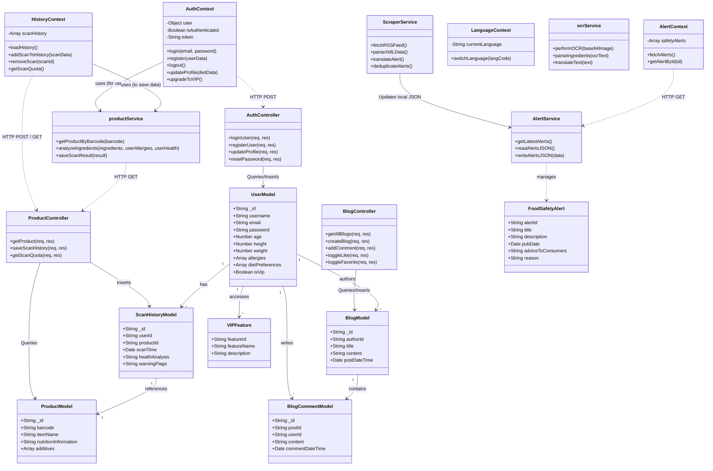

# System Design Class Diagram

This document contains the System Design Class Diagram for the Food Additives Scanning App. It is divided into three main layers to represent the full-stack architecture: **Frontend (React Native)**, **Backend (Express.js)**, and **Database (MongoDB Models)**.

